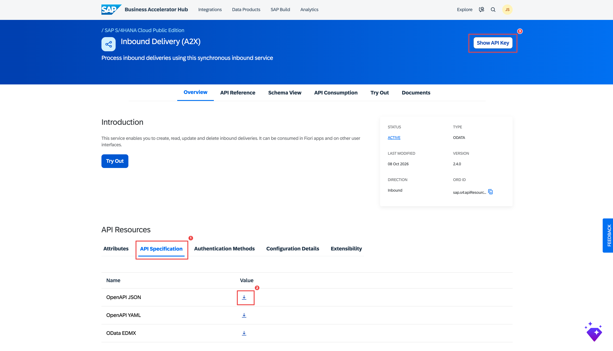

# 3. Inbound Delivery MCP Server

The process for the Inbound Delivery MCP Server is **identical to [Section 1](bah-01-purchase-order.md)** (Purchase Order). This page provides only the Inbound Delivery-specific values. Follow Section 1 for every step — substituting the values below where indicated.

In the supplier-risk story, this server answers: *"What is in transit from this supplier, and when is it due?"*

---

## Inbound Delivery-Specific Values

### API Specification

Download the OpenAPI spec from the [SAP Business Accelerator Hub — Inbound Delivery (A2X) API](https://api.sap.com/api/API_INBOUND_DELIVERY_SRV_0002/overview).

Download it from the **API Specification** section as **OpenAPI JSON** (same as Purchase Order — the `.json` form imports reliably into SAP IS).

### API Artifact Settings (Part C of Section 1)

| Field | Value |
|---|---|
| Upload file | The Inbound Delivery **OpenAPI JSON** file downloaded from BAH |
| URL | `https://sandbox.api.sap.com/s4hanacloud/sap/opu/odata/sap/API_INBOUND_DELIVERY_SRV;v=0002` |
| Service Type | `OData` |
| API Base Path | `/sap/opu/odata/sap/API_INBOUND_DELIVERY_SRV` |

!!! note "Note the version suffix on the URL"
    The backend URL ends with **`;v=0002`** — this selects version 2 of the Inbound Delivery service, which matches the spec you downloaded. Service Type is **`OData`** (like Purchase Order, unlike Business Partner). Everything else — Content Modifier, Trust Upstream MCP Authorization, the `uaa.resource` scope, deploy, publish, subscribe — is identical to Section 1.

### MCP Server Settings (Part F of Section 1)

| Field | Example value |
|---|---|
| Name | `InboundDelivery_MCP` |
| MCP Path | `/inbounddelmcp` |
| Version | `1.0.0` |
| Runtime Profile | `Integration Cell` |

### Recommended Tools to Select (Part F — Create Tools)

This service exposes many operations (45 resources, including writes). Select only the **GET** operations below — these are the ones used in the supplier-risk demo and confirmed working end-to-end:

| Tool | What the AI can do |
|---|---|
| `get_A_InbDeliveryHeader` | List all inbound delivery headers (filter by supplier, date, status) |
| `get_A_InbDeliveryHeader_DeliveryDocument` | Get a single inbound delivery header by its delivery document number |
| `get_A_InbDeliveryItem` | List delivery line items — material and quantity per shipment |
| `get_A_InbDeliveryHeader_DeliveryDocument_to_DeliveryDocumentItem` | Get the items of one specific delivery header |

!!! warning "Read-only — skip all POST / PATCH / DELETE"
    The Inbound Delivery A2X service lists **POST, PATCH, and DELETE** operations (create delivery, update item, delete partner, etc.). The sandbox does **not** allow writes — do not select them. Expose the **GET** tools only.

!!! tip "Fewer tools = sharper agent"
    You can select more GET operations if you like, but the four above are enough for the risk demo. Keeping the tool list small helps the LLM pick the right one and keeps token usage down.

---

## Steps Reference

Follow all parts of [Section 1](bah-01-purchase-order.md) with the values above substituted:

- **Parts A–B** — Use the same Integration Package from Section 1; download the Inbound Delivery spec from BAH
- **Part C** — Upload the Inbound Delivery OpenAPI JSON; use the URL (with `;v=0002`), Service Type (`OData`), and base path above; then enable **Trust Upstream MCP Authorization**
- **Part D** — Add the Content Modifier with the same `APIKey` header (same BAH API key)
- **Parts E–J** — Identical process; use `InboundDelivery_MCP` as the artifact name, select **GET** tools only, and add the `uaa.resource` scope on the MCP Server's Authorization

---

## Checklist

- [ ] Inbound Delivery OpenAPI spec downloaded from SAP BAH
- [ ] API artifact created with the `;v=0002` URL and base path (Service Type `OData`)
- [ ] MCP Server artifact created with Inbound Delivery **GET** tools selected
- [ ] MCP Server deployed (STARTED)
- [ ] Product published and agent subscription created in Developer Hub
- [ ] Credentials (Token URL, Key, Secret) saved

Next: [Material Stock MCP Server →](bah-04-material-stock.md)
