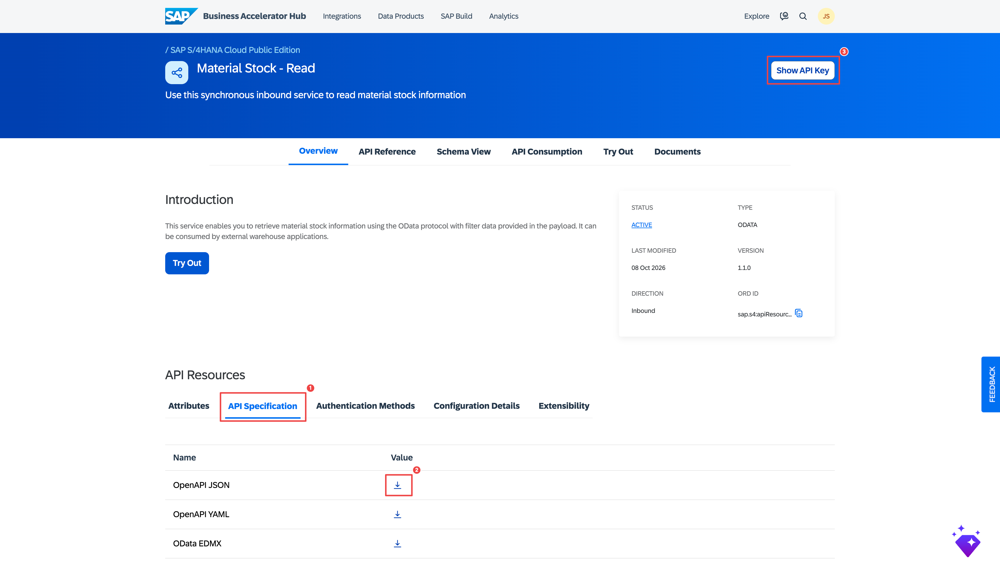

# 4. Material Stock MCP Server

The process for the Material Stock MCP Server is **identical to [Section 1](bah-01-purchase-order.md)** (Purchase Order). This page provides only the Material Stock-specific values. Follow Section 1 for every step — substituting the values below where indicated.

In the supplier-risk story, this server answers: *"Do we have buffer stock on hand if this delivery slips?"*

---

## Material Stock-Specific Values

### API Specification

Download the OpenAPI spec from the [SAP Business Accelerator Hub — Material Stock API](https://api.sap.com/api/API_MATERIAL_STOCK_SRV/overview).

Download it from the **API Specification** section as **OpenAPI JSON** (same as Purchase Order — the `.json` form imports reliably into SAP IS).

### API Artifact Settings (Part C of Section 1)

| Field | Value |
|---|---|
| Upload file | The Material Stock **OpenAPI JSON** file downloaded from BAH |
| URL | `https://sandbox.api.sap.com/s4hanacloud/sap/opu/odata/sap/API_MATERIAL_STOCK_SRV` |
| Service Type | `OData` |
| API Base Path | `/materialstockapi` |

!!! note "Short, custom base path"
    Material Stock uses a short custom **API Base Path** (`/materialstockapi`) rather than the full OData path. Service Type is **`OData`**. Everything else — Content Modifier, Trust Upstream MCP Authorization, the `uaa.resource` scope, deploy, publish, subscribe — is identical to Section 1.

### MCP Server Settings (Part F of Section 1)

| Field | Example value |
|---|---|
| Name | `MaterialStock_MCP` |
| MCP Path | `/materialstockmcp` |
| Version | `1.0.0` |
| Runtime Profile | `Integration Cell` |

### Recommended Tools to Select (Part F — Create Tools)

This service exposes 11 GET resources. Select the ones used in the supplier-risk demo and confirmed working end-to-end:

| Tool | What the AI can do |
|---|---|
| `get_A_MaterialStock` | List materials and their base unit of measure for which stock exists |
| `get_A_MaterialStock_Material` | Get stock info for a specific material (e.g. `TG0013`) |
| `get_A_MatlStkInAcctMod` | Read actual stock quantities in the account model, by plant and storage location |

!!! info "All operations are GET"
    Unlike Inbound Delivery, the Material Stock service is **read-only by nature** — every resource is a GET. There are no write tools to avoid. Still, keep the selection to the three above for a focused agent.

!!! tip "The agent's go-to tool"
    `get_A_MatlStkInAcctMod` is the one the agent reaches for most — it returns the actual quantity on hand per plant/storage location, which is what "do we have buffer?" really means. `get_A_MaterialStock` is the lighter lookup for just confirming a material exists.

---

## Steps Reference

Follow all parts of [Section 1](bah-01-purchase-order.md) with the values above substituted:

- **Parts A–B** — Use the same Integration Package from Section 1; download the Material Stock spec from BAH
- **Part C** — Upload the Material Stock OpenAPI JSON; use the URL, Service Type (`OData`), and base path (`/materialstockapi`) above; then enable **Trust Upstream MCP Authorization**
- **Part D** — Add the Content Modifier with the same `APIKey` header (same BAH API key)
- **Parts E–J** — Identical process; use `MaterialStock_MCP` as the artifact name, select **GET** tools, and add the `uaa.resource` scope on the MCP Server's Authorization

---

## Checklist

- [ ] Material Stock OpenAPI spec downloaded from SAP BAH
- [ ] API artifact created with the Material Stock URL and `/materialstockapi` base path (Service Type `OData`)
- [ ] MCP Server artifact created with Material Stock **GET** tools selected
- [ ] MCP Server deployed (STARTED)
- [ ] Product published and agent subscription created in Developer Hub
- [ ] Credentials (Token URL, Key, Secret) saved

With all four servers deployed and subscribed, you are ready to connect the agent.

Next: [AI Agent Client →](bah-05-ai-agent.md)
